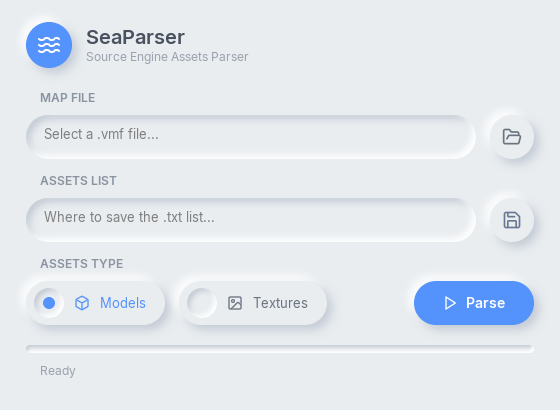

<p align="center">

</p>

<hr />

SeaParser (Source Engine Asset Parser) is user-friendly parser assets from map files. Available on Windows, Linux and ReactOS.

<p align="center">

</p>

## Donate

Available [YooMoney](https://yoomoney.ru/to/4100116203822715) and [DonatePay](https://new.donatepay.ru/@Weronika_Saturday).

Bitcoin (minimum 0.00003 BTC): 
```
bc1q2ep0f54yfymk636aqm5c5rgvcxc7q93jf4qfu4
```
